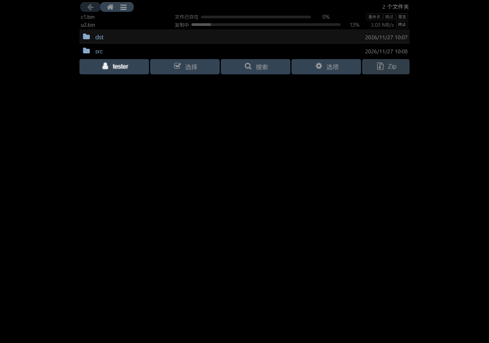

# SafeMove

SafeMove is a large-file migration engine for HFS 3. It does not replace HFS; it takes over qualifying moves and copies at the **`move_files` / `copy_files` API layer**:

- file size is at least the threshold (default: 100 MB)
- source and destination are on different volumes (`st.dev` differs)

Qualifying operations use a server-side queue: **resume from the partial file, throttle, verify with SHA-256, then publish with an atomic rename**. A move deletes the source after publishing; a copy keeps it. Everything else - same-volume moves, small files, folders, unreadable files and symlinks - goes back to the native HFS path. Same-volume moves remain instantaneous `rename`; same-volume copies still use native `copyFile` / FICLONE.

The panel is rendered in the file-browser header, directly below `<div id="folder-stats">`. It shows one live row per transfer for the logged-in account. A completed row shows the integrity result and disappears after a 10-second countdown. All cross-volume jobs run one at a time in a single queue.



---

## Features

- **Only intercepts when needed**: `move_files` / `copy_files` is classified first. If no large cross-volume file is involved, the native API runs untouched with almost no overhead.
- **Works with copy-files unchanged**: copy-files still provides its Copy menu and calls `copy_files` on paste. SafeMove intercepts large cross-volume copies at the HTTP layer and keeps the source.
- **Works with Clipboard-Sync**: SafeMove 1.7 exposes `safemove_move` / `safemove_copy`; Clipboard-Sync 2.3 asks for them on cut and copy paste. Large cross-device pastes enter the SafeMove queue. If SafeMove is missing, stopped or too old, Clipboard-Sync falls back to native `moveFiles` / `copy_files`.
- **Resumable**: data is written to `<name>.part` (visible by default). After a page refresh, HFS restart, busy disk or killed process, the transfer continues from the completed byte count.
- **Throttling**: default **0 (unlimited)**; set a per-second MB cap (for example 6 or 10 MB/s) when the server needs a quieter disk. The row shows the live speed.
- **Integrity check**: source and destination are hashed after the transfer (SHA-256 by default; MD5 or size-only are available). A mismatch restarts the copy once; a second failure stops and lets the user decide.
- **Automatic retries**: configurable count and delay; transient errors go back into the queue and resume instead of restarting from zero.
- **Conflict handling**: when the destination exists, the row offers **Overwrite / Rename / Skip** by default, or a fixed policy can be configured.
- **Pause / Resume / Abort**: running or queued jobs can be paused (keeping `.part`) or aborted (deleting `.part` and the job). Conflicts and failures can be skipped.
- **Interrupted-transfer prompt**: after HFS restarts, a crash or a hot update, a mid-flight job becomes `interrupted` and is not resumed automatically. Entering the source or destination folder shows a prompt to **Resume** or **Delete partial**.
- **Account isolation**: progress is returned only to the account that created the job; the notification channel is derived with HMAC and cannot be subscribed to by another account.
- **Resume after restart**: job state lives in `storage/jobs.json`. By default the destination folder keeps `<name>.part`, which is reused after a restart. The hidden `.hfs-safemove` temp folder is also available.
- **Timestamps preserved**: the source mtime and read-only attribute are restored on the destination, matching a native rename as closely as possible.

## Three-way integration (copy-files + Clipboard-Sync + SafeMove)

copy-files is **not modified**. It still only provides the Copy menu and calls `copy_files` on paste. The other two plugins add synchronization and the transfer engine around it:

```
Cut / Move
  Clipboard-Sync._clipSync_paste
      | api.customApiCall('safemove_move', uris, to, ctx)
  SafeMove.smartTransfer('move')
      |- large cross-volume -> SafeMove queue (source removed when done)
      '- anything else       -> native moveFiles

Copy
  copy-files "Copy"
      | HFS.state.clip.__copy = true
  Clipboard-Sync publishes kind=copy (only while copy-files is running)
      | other devices apply the copy clipboard
  copy-files "Paste" -> HFS.apiCall('copy_files')
      |
  SafeMove.smartTransfer('copy')
      |- large cross-volume -> SafeMove queue (source kept)
      '- anything else       -> native copy_files
```

- SafeMove exposes `safemove_move` / `safemove_copy` through a **static** `exports.customApi`, with `fastmove_move` / `fastmove_copy` aliases for older versions. HFS `customApiCall` only reads static plugin data.
- Clipboard-Sync 2.3 tries `safemove_move` first, then `fastmove_move`, then falls back to `moveFiles`. Missing plugins, stopped plugins and failed calls all keep the native behavior.
- **Copy clipboard gate**: Clipboard-Sync accepts or applies `kind=copy` only while copy-files is running server-side. Otherwise copy clipboards stay local, so they can never be mistaken for a move.
- A completed copy keeps the source and only creates the destination. Progress, throttling, verification, resume, retry and conflict buttons are shared with moves.
- copy-files clears its clipboard with `clip.length = 0` after paste. Clipboard-Sync watches that in-place change and clears the server-side copy clipboard so other devices do not keep a stale entry.
- Clipboard-Sync 2.0 or older has no copy sync; update both plugins together. Old FastMove 1.1 supports moves only.


## Install

1. Put the whole `SafeMove` folder into HFS's `plugins` folder (next to `config.yaml`).
2. Reload plugins, or disable and re-enable `SafeMove` on the Plugins page.
3. Open Admin -> Options -> Plugins -> `SafeMove` to change settings.

The folder name must be `SafeMove` (the plugin id after installation). To publish on GitHub, put the folder contents into the repo's `dist/` and name the repo `hfs-SafeMove`.

```
SafeMove/
├── plugin.js             backend: interception, queue, resume, verification, REST
├── engine.js             pure Node copy/hash engine (independently testable)
├── public/
│   ├── main.js           header progress panel
│   └── style.css         panel styles
├── hfs-lang-zh-TW.json   Traditional Chinese strings
├── hfs-lang-zh.json      Simplified Chinese strings
└── README.md
```

## Settings

| Setting | Default | Description |
|---|---|---|
| Enable SafeMove | On | Off makes every operation use the native path |
| Large-file threshold (MB) | 100 | Minimum size for a cross-volume move or copy to be handled |
| Migration speed limit (MB/s) | 0 | 0 = unlimited (default); applies to the copy phase only |
| Verification speed limit (MB/s) | 0 | Limit for verification reads; 0 = unlimited |
| Incomplete transfers | Visible `.part` | `Visible .part file` keeps `<name>.part` in the destination; `Hidden temp folder` keeps partial data in `.hfs-safemove` |
| Incomplete suffix | `.part` | Marker suffix in visible mode; removed only after the integrity check passes |
| Integrity check | SHA-256 | SHA-256 / MD5 / Size only |
| Automatic retries | 3 | Number of automatic retries for transient errors |
| Retry delay (seconds) | 5 | Base delay per retry (grows up to 5x) |
| When destination exists | Ask | Ask / Overwrite / Rename / Skip |
| Keep completed row (seconds) | 10 | How long the integrity result stays visible |
| Treat same-disk moves as cross-disk (testing) | Off | Testing aid; can also be used to throttle large same-disk transfers |

> This is HFS's native plugin settings page; no separate admin page is needed.

## Usage

1. Log in with an account that has `can_read` / `can_delete` on the source and `can_upload` on the destination.
2. **Move**: Cut a large file and paste it into a folder on another volume.
3. **Copy**: use copy-files' Copy menu, go to the destination and paste; the source is kept.
4. Qualifying jobs appear in the header progress rows. The native toast may report success early, but the file appears in the destination only after the row completes; the panel refreshes the current folder when that happens.
5. Row actions: **Pause** keeps `.part`; **Abort** deletes `.part`; a conflict offers Overwrite / Rename / Skip.
6. After an HFS restart or an interrupted job, entering the source or destination folder shows an **unfinished transfer** prompt with **Resume** and **Delete partial**.

For cross-device copy clipboards, copy-files must stay enabled on the HFS Plugins page. Otherwise copy clipboards stay local (and are never treated as moves).

The panel only shows jobs for the current account. Refreshing the page does not interrupt a transfer; reopening the page reconnects to the existing progress.

## How it works

```
POST /~/api/move_files or /~/api/copy_files
        |
        |- pluginsMiddleware (SafeMove.middleware)
        |     |- classify: size, volume, permissions, symlinks, WebDAV locks
        |     |- no match -> no response; native apiMiddleware runs normally
        |     '- match    -> create job, return errors, ctx.stop()
        |
        '- background worker (one job at a time)
               |- temp file: <dest>\<name>.part (visible by default; .hfs-safemove is optional)
               |- resume: use the temp file size as offset and continue with r+
               |- throttle: sleep after each 1 MiB according to the target rate
               |- verify: SHA-256(source) vs SHA-256(temp)
               |- publish: rename(temp -> destination), restore mtime/mode
               '- cleanup: move moves the uploader attributes and deletes the source; copy keeps it
```

### About `/~/admin/#/options/uploads`

SafeMove does not loop the file back through HFS's upload endpoint: that would add network/protocol overhead and require separate login and path mapping. It borrows the same design:

- write `<name>.part` first, rename to the final name only after completion (no partial file ever appears under the final name)
- resume from an offset instead of restarting from zero
- touch the source only after the destination is published
- respect `isUploading()`: files currently being uploaded are left alone
- keep the temp file on the destination volume so the final rename is atomic

## Known limitations

- **Files only**: folders and symlinks keep their native behavior.
- **A visible `.part` is an accessible file**: it appears in listings and can be downloaded. Set Incomplete transfers to `Hidden temp folder` if partials must stay out of sight.
- **Copy clipboard sync needs copy-files**: SafeMove handles the `copy_files` transfer; Clipboard-Sync syncs the copy clipboard, and copy-files must be running server-side. Without copy-files, copy still works but stays local.
- **Verification cost**: SHA-256 reads both files once. For very large files on a quiet server, lower Verification speed limit or use Size only.
- **Not a full hard-link / sparse-file / ADS copier**: normal contents and timestamps are preserved; Windows Alternate Data Streams are not.
- **Depends on HFS internals**: it uses `./vfs`, `./frontEndApis`, `./upload`, `./uploadOwners`, `./webdav` and `./misc`. `apiRequired` is pinned to 13.73 (HFS 3.4.2); internal API changes may need adjustments after an HFS upgrade.
- **One cross-volume job at a time** (deliberate); same-volume and small operations are unaffected.
- If the destination volume root is not writable, the temp folder falls back to `.hfs-safemove/` inside the destination folder; the hidden folder may briefly appear in listings (Windows gets the hidden attribute when possible).

## Development and tests

`engine.js` has no HFS dependency and can be run directly:

```bash
node SafeMove/tests/engine.test.js
```

Coverage: resume from an offset, throttle accuracy, hash comparison, unique names.

Integration tests need an isolated HFS 3.4.2 site (for example `--cwd` pointing at a temp folder, port 8099):

```bash
node SafeMove/tests/ui.test.mjs        # header panel, progress bar, buttons
node SafeMove/tests/ui-action.test.mjs # row actions, completed row, 10s countdown
node SafeMove/tests/three.test.mjs     # copy-files + Clipboard-Sync + SafeMove
node SafeMove/tests/prompt.test.mjs    # Resume / Delete partial prompt in source/destination
```

The UI tests assume the site uses `tester` / `secret123` and has `/src` and `/dst`; the two UI tests need a running job and a conflict job prepared first. The three-way test needs copy-files, Clipboard-Sync and SafeMove all enabled and connects to `127.0.0.1:8095` by default; set `THREE_ROOT` to the site folder. The prompt test connects to `127.0.0.1:8092` by default; set `PROMPT_ROOT`. These are development repro scripts, not zero-setup CI tests.

Verified during development:

- 50 MB at 20 MB/s: completed, SHA-256 matched, source deleted
- 200 MB killed mid-transfer: resumed from 44 MB after restart, final hash matched
- 50 MB same volume: native completion in 55 ms, no queue entry
- conflict: waiting buttons -> overwrite succeeded; rename succeeded; skip kept the original
- two jobs submitted together: the second showed `Queued #1`
- pause / resume: `paused` kept `.part`; Resume continued from that size and renamed only after completion
- interrupted: killed HFS mid-transfer; after restart the job was `interrupted` (no auto-resume); entering `/dst/` showed the prompt; Resume continued from 3 MB and the hash matched
- abort: Delete partial removed the job and `.part`, and kept the source
- two accounts: neither saw the other's jobs; a wrong SSE channel returned 403
- Clipboard-Sync 2.3 + SafeMove 1.7: `_clipSync_paste` returned `moved:1`, the source remained after paste, SafeMove showed progress, final hash matched
- Clipboard-Sync 2.3 + SafeMove stopped: native `moveFiles` fallback, immediate paste, hash matched
- `copy_files` 20 MB across volumes: job `op=copy`, final hash matched, source kept, destination created; with SafeMove stopped it used native `copy_files`
- visible `.part`: `m1.bin.part` appeared during transfer; after killing HFS it kept 5 MB, resumed from 6 MB, and was renamed to `m1.bin` with a matching hash
- copy-files + Clipboard-Sync + SafeMove: copy clipboard published across devices, paste executed by copy-files, SafeMove queued it as a copy, and clearing the clipboard in copy-files cleared the server state
- copy-files stopped: `copySupported=false`; Clipboard-Sync refused to publish the copy clipboard
- real Chrome: panel below `#folder-stats`, advancing bar, speed display, completed row countdown and disappearance

## Publishing

```js
exports.repo = "hugo529100/hfs-SafeMove"
```

GitHub repo recommendations:

- repo name: `hfs-SafeMove` (HFS shows it as `SafeMove`)
- put the installable contents in `dist/`
- topic: `hfs-plugin`
- `exports.apiRequired = 13.73` is declared

## License

Same as HFS: GPL-3.0.
